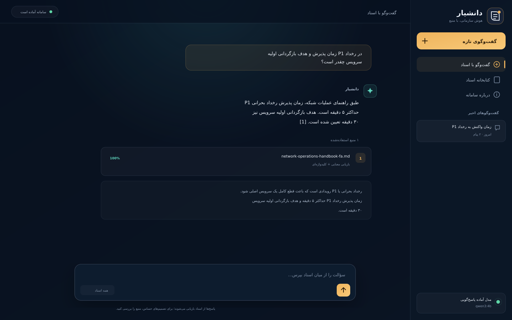
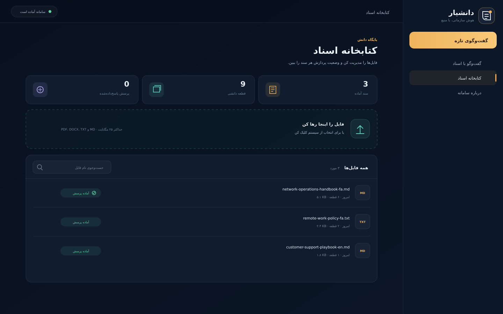

# Daaneshyar

### A Persian-first RAG workspace for answers you can trace back to the source

[فارسی](README.fa.md) · [Architecture](docs/architecture.md) · [API](docs/api.md) · [Demo guide](docs/demo-guide-fa.md)

Daaneshyar is a complete, local-first Retrieval-Augmented Generation
application. Upload PDF, DOCX, Markdown, or text files; ask questions in Persian
or English; and receive streamed answers with the exact document, page, and
evidence excerpt behind each claim.

**For prospective clients:** Daaneshyar showcases source-cited, Persian-first document search and answers, hybrid retrieval, and a reproducible demo mode. [Browse selected AI & automation projects](https://github.com/Abouzarsh/n8n-lead-qualification-automation/blob/main/PORTFOLIO.md). Review [architecture](docs/architecture.md) and the instructions below before deployment.

I built it to answer a practical question: how do we make a document assistant
useful when a confident answer is not enough and the user also needs to verify
where it came from?

## What makes it more than “chat with a PDF”

- Hybrid retrieval combines multilingual dense embeddings with SQLite FTS5.
- Weighted Reciprocal Rank Fusion prevents either search method from dominating.
- Every answer carries inspectable citations, page numbers, and evidence text.
- Persian and Arabic character variants are normalized before lexical indexing.
- Answers stream from Ollama to the browser through Server-Sent Events.
- Document ingestion runs outside the request lifecycle and exposes its status.
- Conversation history, document metadata, and citations persist in SQLite.
- Duplicate files are detected by SHA-256 before expensive embedding work.
- Local mode keeps documents and prompts on the machine.
- A deterministic zero-download mode makes tests and UI demos reproducible.

## Architecture at a glance

~~~mermaid
flowchart LR
    A["PDF · DOCX · TXT · MD"] --> B["Extract + normalize"]
    B --> C["Sentence-aware chunks"]
    C --> D["Multilingual embeddings"]
    D --> E["Qdrant"]
    C --> F["SQLite FTS5"]
    Q["User question"] --> G["Hybrid retrieval + RRF"]
    E --> G
    F --> G
    G --> H["Grounded prompt"]
    H --> I["Ollama / compatible LLM"]
    I --> J["Streamed answer + citations"]
~~~

The backend does not hide retrieval behind a framework abstraction. Chunking,
fusion, prompt construction, persistence, and citation mapping are small,
testable modules in backend/app/rag.

## Stack

| Layer | Technology | Why it is here |
| --- | --- | --- |
| API | FastAPI | Typed endpoints, automatic docs, streaming responses |
| Web app | React + TypeScript + Vite | Responsive Persian UI with a small client bundle |
| Semantic search | Qdrant | Fast vector search, filtering, local or server mode |
| Lexical search | SQLite FTS5 | Exact names, codes, and Persian terms |
| Embeddings | Ollama embeddinggemma | Multilingual vectors without a Python ML runtime |
| Generation | Ollama, default qwen3:4b | Private local inference; no paid API required |
| Persistence | SQLite | Portable metadata and conversation history |
| Delivery | Docker Compose + Nginx | Reproducible local deployment and SSE proxying |

## Quick start: full local mode

### Requirements

- Python 3.11 or 3.12
- Node.js 20.19 or newer
- Ollama
- Git

On Windows PowerShell:

    git clone https://github.com/Abouzarsh/daaneshyar-rag.git
    cd daaneshyar-rag
    Copy-Item .env.example .env
    .\scripts\setup.ps1
    ollama pull qwen3:4b
    ollama pull embeddinggemma
    .\scripts\run-dev.ps1

Open http://localhost:5173. FastAPI documentation is available at
http://localhost:8000/docs.

Both generation and embeddings run through the local Ollama service. An
optional in-process Sentence Transformers adapter is also included for teams
that prefer a Python model runtime.

### macOS or Linux

    cp .env.example .env
    python3.12 -m venv .venv
    source .venv/bin/activate
    pip install -e "./backend[dev]"
    cd frontend && npm ci && cd ..
    ollama pull qwen3:4b
    ollama pull embeddinggemma

Run the two development processes:

    cd backend
    uvicorn app.main:app --reload --port 8000

    cd frontend
    npm run dev

## Quick start: Docker

Keep Ollama running on the host, then:

    cp .env.example .env
    docker compose up --build

Open http://localhost:3000. Docker Compose starts the web app, API, and Qdrant;
generation and embeddings use the Ollama service running on the host.

## Zero-download demo mode

For API development or a quick UI preview without Qdrant, Ollama, or model
weights, set:

    RAG_DEMO_MODE=true

Demo mode uses deterministic hash embeddings, an in-memory vector store, and a
small extractive response provider. It exercises the complete product flow but
is not intended to measure semantic quality.

After the API starts, load the fictional sample documents:

    python scripts/seed_demo.py

They cover network operations, remote work, and an English support playbook.
No sample contains real organizational information.

## API surface

| Method | Endpoint | Purpose |
| --- | --- | --- |
| GET | /api/v1/health | Component health and active model |
| GET | /api/v1/stats | Knowledge-base and usage counters |
| POST | /api/v1/documents | Upload one or more documents |
| GET | /api/v1/documents | List documents and ingestion status |
| DELETE | /api/v1/documents/{id} | Remove file, chunks, and vectors |
| POST | /api/v1/chat/stream | Stream answer and source events over SSE |
| GET | /api/v1/conversations | List previous conversations |
| GET | /api/v1/conversations/{id} | Read messages and citations |
| DELETE | /api/v1/conversations/{id} | Delete a conversation |

See [docs/api.md](docs/api.md) for event shapes and request examples.

## Tests and evaluation

Backend tests run entirely offline:

    cd backend
    pytest --cov=app --cov-report=term-missing

Build and type-check the frontend:

    cd frontend
    npm run build
    npm run lint

For a live retrieval smoke test, seed the sample documents and run:

    python scripts/evaluate.py

The evaluator verifies that the expected source appears in retrieval results. It
does not call that check a full RAG quality score; answer correctness still
needs a human or a purpose-built evaluation model.

## Repository map

    backend/app/api/        HTTP routes and schemas
    backend/app/rag/        chunking, embeddings, retrieval, prompts, LLMs
    backend/app/services/   ingestion and document lifecycle
    backend/tests/          offline unit and end-to-end API tests
    frontend/src/           Persian React interface
    samples/                fictional bilingual demo documents
    scripts/                setup, seeding, and evaluation helpers
    docs/                   architecture, API, decisions, and portfolio notes

## Engineering choices and limits

This repository is deliberately honest about scope:

- Sentence-aware word windows are easier to inspect than model-token windows,
  but very unusual formatting can still split context awkwardly.
- FTS5 is excellent for a single-node portfolio product. A multi-tenant service
  would likely move metadata and lexical retrieval to PostgreSQL.
- BackgroundTasks keeps the deployment simple. A production system with large
  files should use a durable queue such as Celery, Dramatiq, or a cloud queue.
- Authentication is intentionally absent from this single-user demo. Add an
  identity provider and tenant filters before exposing it to multiple users.
- Scanned PDFs require OCR before upload in version 1.0.

The reasoning behind these choices is recorded in
[docs/architecture.md](docs/architecture.md).

## Roadmap

- OCR pipeline for scanned Persian documents
- Optional cross-encoder reranking
- Retrieval feedback and evaluation dashboard
- User authentication and tenant-level isolation
- MinIO or S3-compatible document storage

## Author

Built by **Aboozar Shabnani** as a practical full-stack RAG portfolio project.

If you use the project, a note about what you changed or learned is always
welcome.

## License

MIT — see [LICENSE](LICENSE).
